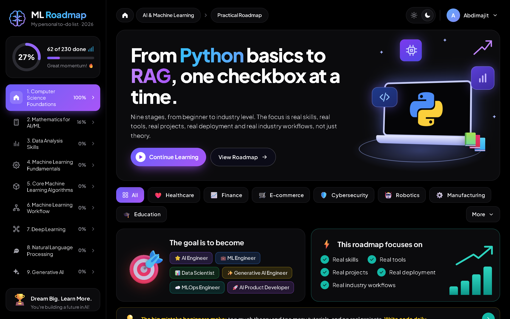
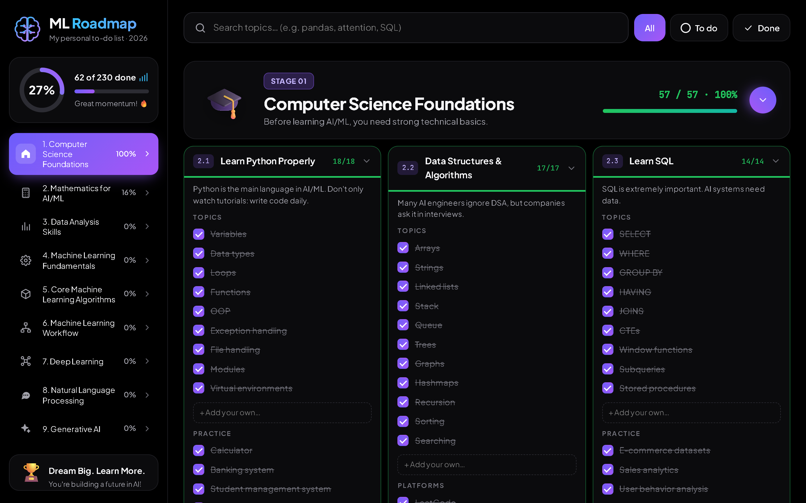
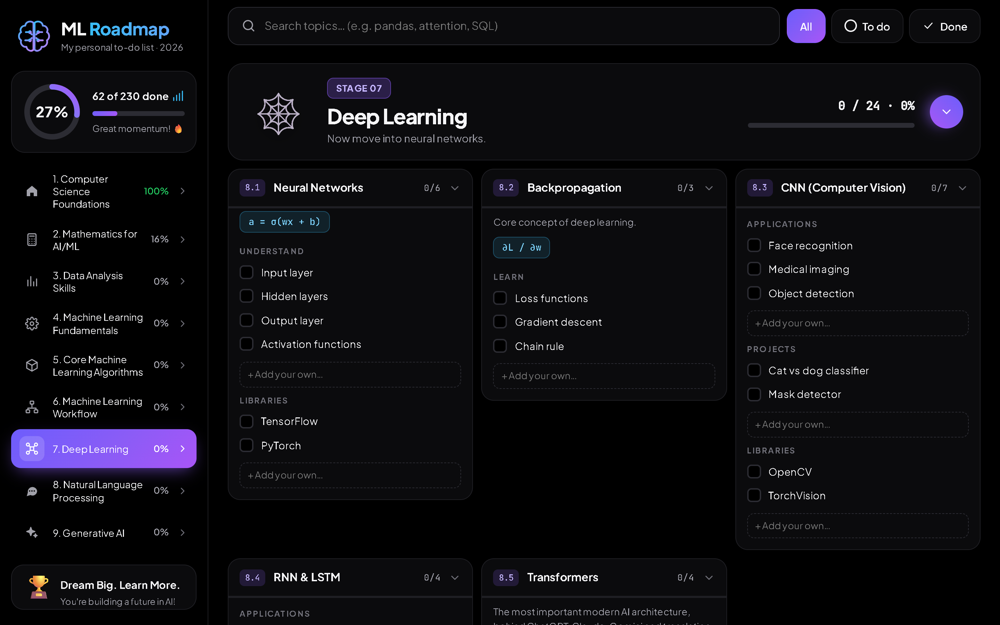
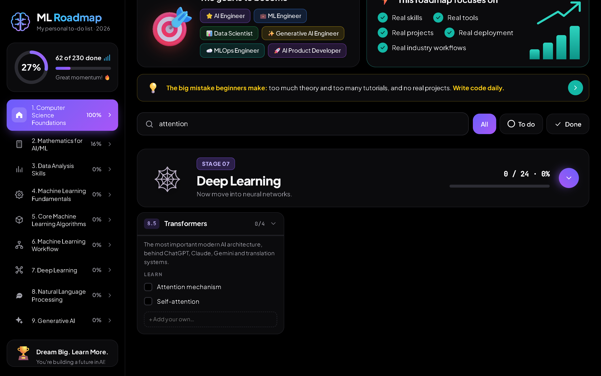
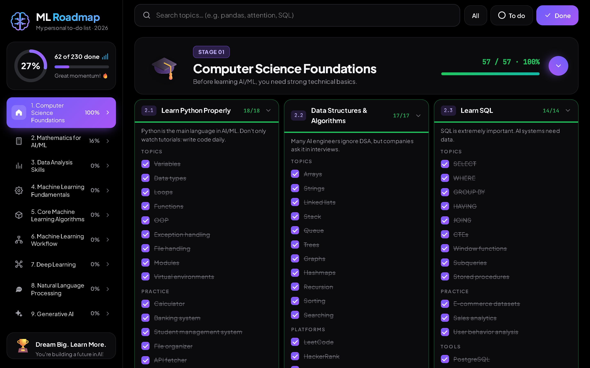
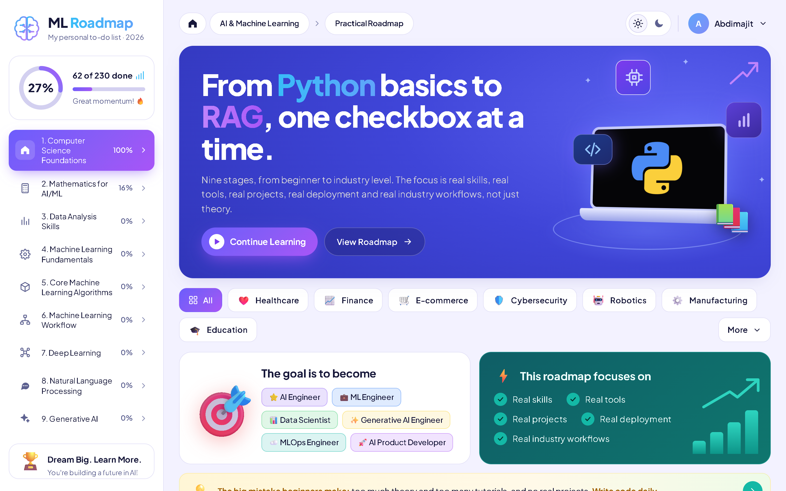
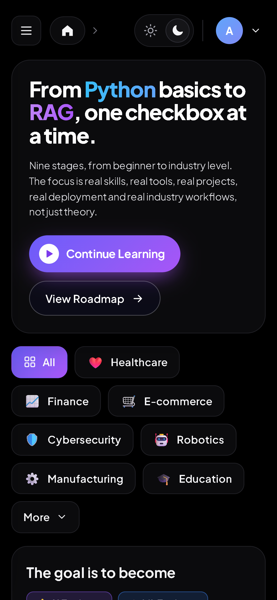
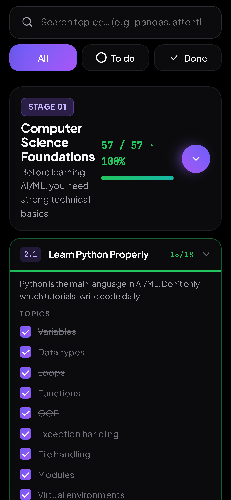

# ML Roadmap: Preview

A personal to-do tracker for the **AI & Machine Learning Practical Roadmap (2026)**: nine stages, from Python basics to RAG, one checkbox at a time.

This repo only holds screenshots of the app. The source code is kept in a private repo.

## What it does

- **230 checklist items** across 9 stages and 39 sections, taken from the full roadmap
- **Progress everywhere**: an overall ring, a percentage per stage in the sidebar, and a bar for each stage and section
- **Continue Learning** jumps straight to your next unticked task
- **Add your own items** to any list
- **Search** plus **All / To do / Done** filters
- **Black and light themes**
- **Saved in the browser**, with JSON export and import for backups
- **Responsive**: works on desktop and phone

## The 9 stages

| # | Stage | Covers |
|---|---|---|
| 1 | Computer Science Foundations | Python, DSA, SQL, Git & GitHub |
| 2 | Mathematics for AI/ML | Linear algebra, statistics, calculus, optimization |
| 3 | Data Analysis Skills | NumPy, Pandas, visualization, EDA |
| 4 | Machine Learning Fundamentals | Supervised, unsupervised, reinforcement learning |
| 5 | Core ML Algorithms | Regression, decision trees, random forest, SVM, KNN, Naive Bayes, clustering |
| 6 | ML Workflow | Data collection, cleaning, feature engineering, training, evaluation, tuning |
| 7 | Deep Learning | Neural networks, backpropagation, CNN, RNN/LSTM, Transformers |
| 8 | Natural Language Processing | Text processing, vectorization, NLP projects, LLMs |
| 9 | Generative AI | Prompt engineering, RAG |

## Screenshots

### Stage checklist
Each stage has a banner with its progress, and its sections sit in a grid of cards. A finished stage turns green.

### Deep Learning stage
Key formulas are shown inside each section.

### Search

### Done filter

### Light theme

### Mobile

  
  &nbsp;
  

## Built with

A single HTML file using plain HTML, CSS and JavaScript, with no frameworks or build step. Progress is stored in `localStorage`.
